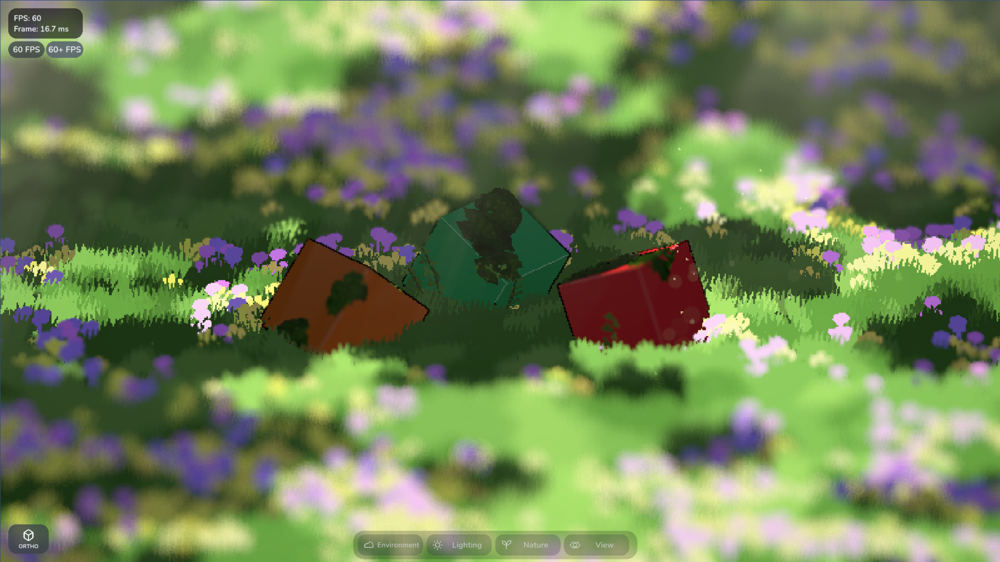

# Althaf Tristan Maheswara

Game Developer & Software Engineer based in Indonesia, building games with Unity and C#. I'm also learning to build desktop apps and tools.

[View my portfolio](https://althafm.is-a.dev) · [Play my games](https://althafm.itch.io) · [YouTube](https://www.youtube.com/@AlthafGameDev)

## Selected work

- **[Games & prototypes](https://althafm.is-a.dev/#work)**: Bounce!, RogueBlast: Pixel Puzzle, Undertaker, and Exsilva Project
- **[Current prototype](https://althafm.is-a.dev/#current)**: A browser-based 3D pixel scene exploring lighting, atmosphere, and interactive environments
- **[Dictately](https://github.com/AlthafTM/dictately)**: A local Windows dictation app that turns speech into text in the active input field, with support for **English** and **Indonesian**
- **[Dropflip](https://github.com/AlthafTM/dropflip)**: A Windows drop-zone app for local file conversion and compression

## Skills & tools

- **Game development:** Unity, C#, UI, animation, and shaders
- **Programming:** C, C++, and Go (Golang)
- **Design & creative tools:** Figma and Blender, with ongoing learning in visual design and 3D workflows

## Contact

For project inquiries and collaboration, visit my [portfolio](https://althafm.is-a.dev/#contact) or reach me on Discord: **volxess**

---

Current project sneak peek

*A sneak peek at the Unity project I'm currently working on.*

[Play the demo](https://althafm.is-a.dev/play/)

